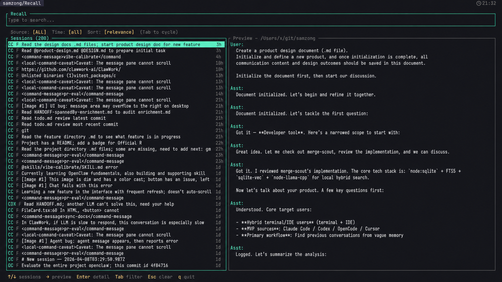
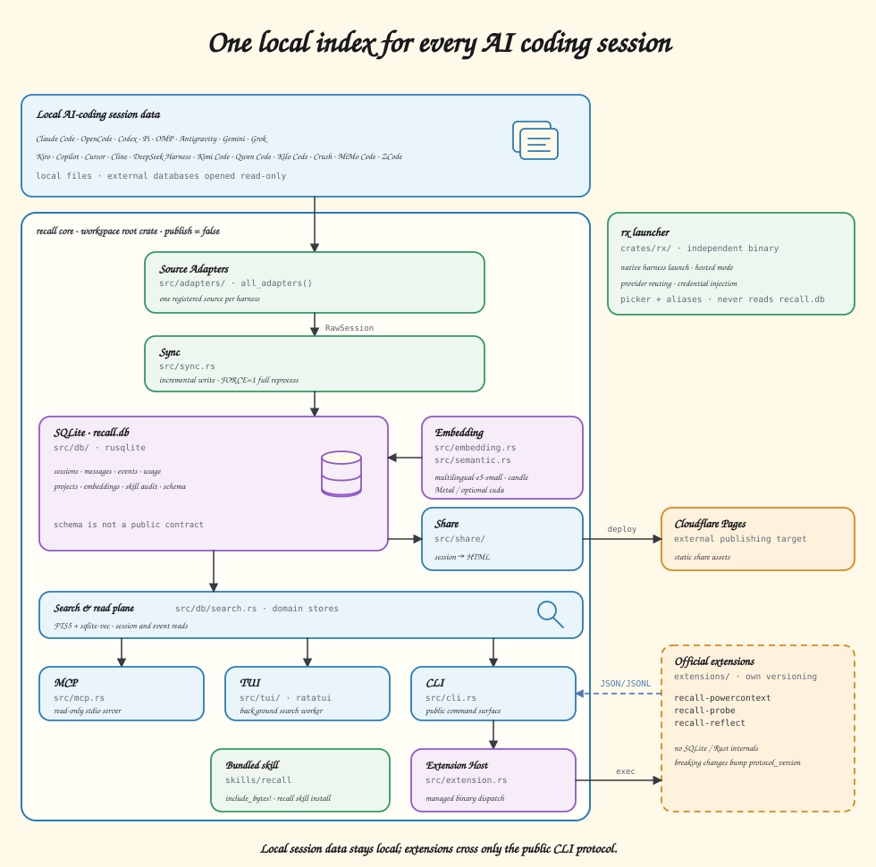

# Recall

> Local-first search across every AI coding session on your machine.

[](https://asciinema.org/a/909453)

Jump between Claude Code, Codex, and whatever comes next; Recall pulls those scattered local sessions into one searchable index, tracks usage when token metadata is available, and drops you back into the original CLI.

## Architecture



## Install

```bash
brew install samzong/tap/recall
```

## Usage

```bash
recall sync          # incremental sync of the current project (safe to run anytime)
recall sync --project all  # sync every project and run index-wide maintenance
recall               # launch TUI
recall usage         # usage dashboard
recall export --project all > recall-export.jsonl # export all sessions
recall import recall-export.jsonl --dry-run  # preview an import
recall session list  # list sessions for agents/scripts
recall session share --id <session-id> --format json  # publish one selected session
recall share list --format json  # list published share URLs
recall share unpublish <share-id> --yes  # take down one public page
recall info  # index stats and worker status
```

Usage reporting rules:

- The `--time` flag uses local midnight for `today` and rolling `7 * 24` hour or `30 * 24` hour windows for `7d` and `30d`.
- The `--card --period` flag uses local calendar day boundaries starting at local midnight, and `--json` rollups use local calendar day, week, and month boundaries.
- `recall usage --projects` and the TUI `Projects` tab aggregate all indexed sessions globally, while `--project <dir>` scopes local directories via `native_bindings`.
- Recall reports only observed provider and client token buckets without synthetic USD cost estimation or unverified token guessing.

With Skill use **Recall** is the best way.

```bash
recall skill install # auto detect agents and install skills
```

## Support

Antigravity desktop sessions use source `antigravity` (`AGYD`) and come from `~/.gemini/antigravity/brain/`.
CLI and ACP sessions use source `antigravity-cli` (`AGY`) and come from `~/.gemini/antigravity-cli/` and `~/.gemini/antigravity-acp/`.
Desktop resume is not supported.
Usage tracking reads local `conversations/*.db` files for both desktop and CLI sources.
Run `recall sync --source antigravity --project all`, then `recall session list --source antigravity --project all`.
Project filters read workspace paths from `conversation_summaries.db`, `history.jsonl`, `.meta` files, and `conversations/*.db`.
If those workspace sources are missing or unreadable, global search still includes the transcripts without project paths.

One index across every AI coding CLI. Sync once, search everywhere, resume right where you left off.

| Adapter         | Discovery | Full-index | Incremental-sync | Semantic-search | Export | Resume | Usage |
| --------------- | :-------: | :--------: | :--------------: | :-------------: | :-------------: | :----: | :----: |
| Claude Code     |     ✅    |     ✅     |        ✅        |        ✅       |        ✅       |   ✅   |   ✅   |
| OpenCode        |     ✅    |     ✅     |        ✅        |        ✅       |        ✅       |   ✅   |   ✅   |
| Codex           |     ✅    |     ✅     |        ✅        |        ✅       |        ✅       |   ✅   |   ✅   |
| Pi              |     ✅    |     ✅     |        ✅        |        ✅       |        ✅       |   ✅   |   ✅   |
| OMP             |     ✅    |     ✅     |        ✅        |        ✅       |        ✅       |   ✅   |   ✅   |
| rx-agent        |     ✅    |     ✅     |        ✅        |        ✅       |        ✅       |   ✅   |   ✅   |
| Antigravity CLI |     ✅    |     ✅     |        ✅        |        ✅       |        ✅       |   ✅   |   ✅   |
| Antigravity desktop |     ✅    |     ✅     |        ✅        |        ✅       |        ✅       |   —    |   ✅   |
| Gemini          |     ✅    |     ✅     |        ✅        |        ✅       |        ✅       |   ✅   |   ✅   |
| Kiro            |     ✅    |     ✅     |        ✅        |        ✅       |        ✅       |   —    |       |
| Copilot     |     ✅    |     ✅     |        ✅        |        ✅       |        ✅       |   ✅   |   ✅   |
| Copilot Chat |     ✅    |     ✅     |        ✅        |        ✅       |        ✅       |   —    |      |
| Cursor          |     ✅    |     ✅     |        ✅        |        ✅       |        ✅       |   —    |   ✅   |
| Cline           |     ✅    |     ✅     |        ✅        |        ✅       |        ✅       |   —    |       |
| Roo             |     ✅    |     ✅     |        ✅        |        ✅       |        ✅       |   —    |       |
| DeepSeek Harness |     ✅    |     ✅     |        ✅        |        ✅       |        ✅       |   —    |   ✅   |
| Grok            |     ✅    |     ✅     |        ✅        |        ✅       |        ✅       |   ✅   |   ✅   |
| Kimi Code       |     ✅    |     ✅     |        ✅        |        ✅       |        ✅       |   ✅   |   ✅   |
| MiniMax Code    |     ✅    |     ✅     |        ✅        |        ✅       |        ✅       |   ✅   |   ✅   |
| Qoder CLI       |     ✅    |     ✅     |        ✅        |        ✅       |        ✅       |   ✅   |   ✅   |
| Qwen Code       |     ✅    |     ✅     |        ✅        |        ✅       |        ✅       |   ✅   |   ✅   |
| Kilo Code       |     ✅    |     ✅     |        ✅        |        ✅       |        ✅       |   ✅   |   ✅   |
| Crush           |     ✅    |     ✅     |        ✅        |        ✅       |        ✅       |   ✅   |   ✅   |
| MiMo Code       |     ✅    |     ✅     |        ✅        |        ✅       |        ✅       |   ✅   |   ✅   |
| ZCode           |     ✅    |     ✅     |        ✅        |        ✅       |        ✅       |   ✅   |   ✅   |
| Goose           |     ✅    |     ✅     |        ✅        |        ✅       |        ✅       |   ✅   |   ✅   |
| Droid           |     ✅    |     ✅     |        ✅        |        ✅       |        ✅       |   ✅   |   ✅   |
| Amp             |     ✅    |     ✅     |        ✅        |        ✅       |        ✅       |   ✅   |      |
| OpenHands       |     ✅    |     ✅     |        ✅        |        ✅       |        ✅       |   ✅   |      |
| Devin           |     ✅    |     ✅     |        ✅        |        ✅       |        ✅       |   ✅   |   ✅   |
| Muse Code       |     ✅    |     ✅     |        ✅        |        ✅       |        ✅       |   ✅   |   ✅   |
| CodeBuddy       |     ✅    |     ✅     |        ✅        |        ✅       |        ✅       |   ✅   |   ✅   |
| TRAE CLI        |     ✅    |     ✅     |        ✅        |        ✅       |        ✅       |   ✅   |   ✅   |
| JetBrains Junie |     ✅    |     ✅     |        ✅        |        ✅       |        ✅       |   ✅   |   ✅   |
| Zed             |     ✅    |     ✅     |        ✅        |        ✅       |        ✅       |   —    |   ✅   |
| Warp            |     ✅    |     ✅     |        ✅        |        ✅       |        ✅       |   —    |   ✅   |

Qoder CLI usage requires exposed, nonzero token counts. Cache-inclusive input is split into fresh input, cache read, and cache write. Hidden token counts are not estimated.

rx-agent sessions use `$RX_HOME/sessions` (default `~/.rx/sessions`). Recall reads version 1 logs and preserves the complete history across compaction checkpoints.

Grok usage reads `turn_completed.usage` records from `updates.jsonl` and reconciles interrupted turns with `unified.jsonl`. When neither source exists for a turn, Recall falls back to `_meta.totalTokens`. Recall excludes Grok `subagent` and `subagent_resume` sessions. Interrupted turns that rotated out of `unified.jsonl` before re-parse fall back to `_meta.totalTokens` when present and otherwise emit no usage.

## Acknowledgements

- Thanks to [tokscale](https://github.com/junhoyeo/tokscale) for the usage dashboard reference and token accounting behavior.
- Thanks to [Ratatui](https://github.com/ratatui/ratatui) and [Crossterm](https://github.com/crossterm-rs/crossterm) for the terminal UI foundation.
- Thanks to [sqlite-vec](https://github.com/asg017/sqlite-vec) and SQLite FTS5 for keeping local text and vector search embedded.
- Thanks to [Candle](https://github.com/huggingface/candle), Hugging Face, and [intfloat/multilingual-e5-small](https://huggingface.co/intfloat/multilingual-e5-small) for local semantic embeddings.
- Thanks to [kitup](https://github.com/samzong/kitup) for the bundled agent skill installer.
- Thanks to [LINUX DO](https://linux.do/) for the open-source sharing community.

## License

This project is licensed under the [MIT](LICENSE) License.
