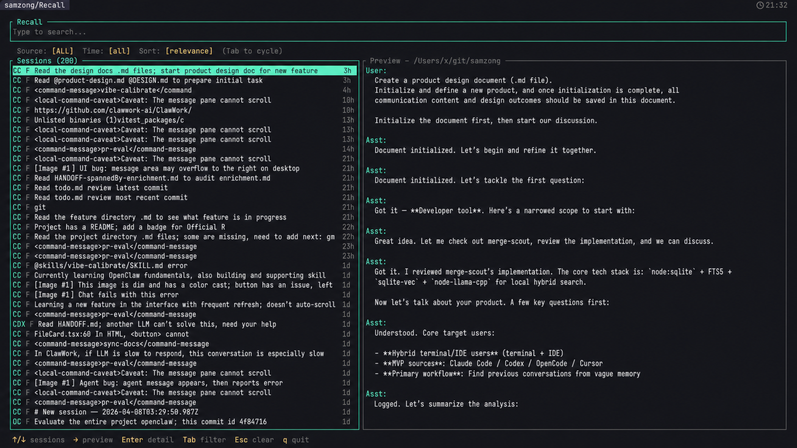
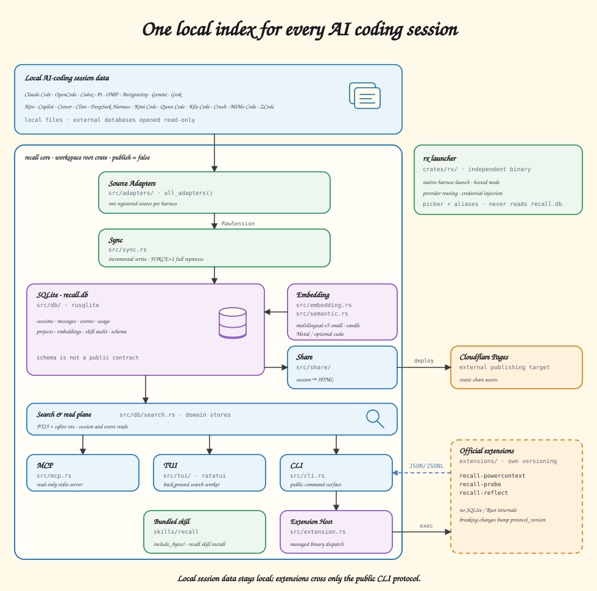

[English](./README.md) | [Chinese](./README.zh-CN.md) | **Türkçe**

# Recall

> Makinenizdeki tüm yapay zekâ kodlama oturumlarında yerel öncelikli arama.

[](https://asciinema.org/a/909453)

Claude Code, Codex ve bundan sonra gelecek araçlar arasında geçiş yapın; Recall bu dağınık yerel oturumları tek bir aranabilir dizinde toplar, token meta verisi mevcut olduğunda kullanımı takip eder ve sizi doğrudan orijinal CLI'a geri döndürür.

## Mimari



## Kurulum

```bash
brew install samzong/tap/recall
```

## Kullanım

```bash
recall sync          # incremental sync of the current project (safe to run anytime)
recall sync --project all  # sync every project and run index-wide maintenance
recall               # launch TUI
recall usage         # usage dashboard
recall export --project all > recall-export.jsonl # export all sessions
recall import recall-export.jsonl --dry-run  # preview an import
recall session list  # list sessions for agents/scripts
recall session share --id <session-id> --format json  # publish one selected session
recall share list --format json  # list published share URLs
recall share unpublish <share-id> --yes  # take down one public page
recall info  # index stats and worker status
```

Skill ile kullanmak **Recall** için en iyi yoldur.

```bash
recall skill install # auto detect agents and install skills
```

## Destek

Antigravity masaüstü oturumları `antigravity` (`AGYD`) kaynağını kullanır ve `~/.gemini/antigravity/brain/` konumundan gelir.
CLI oturumları `antigravity-cli` (`AGY`) kaynağını korur. Masaüstü sürümünde oturum devam ettirme ve kullanım takibi desteklenmez.
`recall sync --source antigravity --project all` ve ardından `recall session list --source antigravity --project all` komutlarını çalıştırın.
Masaüstü proje filtreleri `conversation_summaries.db` içindeki ilk yerel çalışma alanı URI'sini kullanır.
Bu veritabanı eksik veya okunamıyorsa, genel arama yine de proje yolları olmadan transkriptleri içerir.

Her yapay zekâ kodlama CLI'ı için tek dizin. Bir kez senkronize edin, her yerde arayın, kaldığınız yerden devam edin.

| Bağdaştırıcı (Adapter) | Keşif | Tam dizin | Artımlı senkronizasyon | Anlamsal arama | Dışa aktarma | Devam ettirme | Kullanım |
| --------------- | :-------: | :--------: | :--------------: | :-------------: | :-------------: | :----: | :----: |
| Claude Code     |     ✅    |     ✅     |        ✅        |        ✅       |        ✅       |   ✅   |   ✅   |
| OpenCode        |     ✅    |     ✅     |        ✅        |        ✅       |        ✅       |   ✅   |   ✅   |
| Codex           |     ✅    |     ✅     |        ✅        |        ✅       |        ✅       |   ✅   |   ✅   |
| Pi              |     ✅    |     ✅     |        ✅        |        ✅       |        ✅       |   ✅   |   ✅   |
| OMP             |     ✅    |     ✅     |        ✅        |        ✅       |        ✅       |   ✅   |   ✅   |
| rx-agent        |     ✅    |     ✅     |        ✅        |        ✅       |        ✅       |   ✅   |   ✅   |
| Antigravity CLI |     ✅    |     ✅     |        ✅        |        ✅       |        ✅       |   ✅   |      |
| Antigravity desktop |     ✅    |     ✅     |        ✅        |        ✅       |        ✅       |   —    |      |
| Gemini          |     ✅    |     ✅     |        ✅        |        ✅       |        ✅       |   ✅   |   ✅   |
| Kiro            |     ✅    |     ✅     |        ✅        |        ✅       |        ✅       |   —    |       |
| Copilot     |     ✅    |     ✅     |        ✅        |        ✅       |        ✅       |   ✅   |   ✅   |
| Copilot Chat |     ✅    |     ✅     |        ✅        |        ✅       |        ✅       |   —    |      |
| Cursor          |     ✅    |     ✅     |        ✅        |        ✅       |        ✅       |   —    |   ✅   |
| Cline           |     ✅    |     ✅     |        ✅        |        ✅       |        ✅       |   —    |       |
| Roo             |     ✅    |     ✅     |        ✅        |        ✅       |        ✅       |   —    |       |
| DeepSeek Harness |     ✅    |     ✅     |        ✅        |        ✅       |        ✅       |   —    |   ✅   |
| Grok            |     ✅    |     ✅     |        ✅        |        ✅       |        ✅       |   ✅   |   ✅   |
| Kimi Code       |     ✅    |     ✅     |        ✅        |        ✅       |        ✅       |   ✅   |   ✅   |
| MiniMax Code    |     ✅    |     ✅     |        ✅        |        ✅       |        ✅       |   ✅   |   ✅   |
| Qoder CLI       |     ✅    |     ✅     |        ✅        |        ✅       |        ✅       |   ✅   |   ✅   |
| Qwen Code       |     ✅    |     ✅     |        ✅        |        ✅       |        ✅       |   ✅   |   ✅   |
| Kilo Code       |     ✅    |     ✅     |        ✅        |        ✅       |        ✅       |   ✅   |   ✅   |
| Crush           |     ✅    |     ✅     |        ✅        |        ✅       |        ✅       |   ✅   |   ✅   |
| MiMo Code       |     ✅    |     ✅     |        ✅        |        ✅       |        ✅       |   ✅   |   ✅   |
| ZCode           |     ✅    |     ✅     |        ✅        |        ✅       |        ✅       |   ✅   |   ✅   |
| Goose           |     ✅    |     ✅     |        ✅        |        ✅       |        ✅       |   ✅   |   ✅   |
| Droid           |     ✅    |     ✅     |        ✅        |        ✅       |        ✅       |   ✅   |   ✅   |
| Amp             |     ✅    |     ✅     |        ✅        |        ✅       |        ✅       |   ✅   |      |
| OpenHands       |     ✅    |     ✅     |        ✅        |        ✅       |        ✅       |   ✅   |      |
| Devin           |     ✅    |     ✅     |        ✅        |        ✅       |        ✅       |   ✅   |   ✅   |
| Muse Code       |     ✅    |     ✅     |        ✅        |        ✅       |        ✅       |   ✅   |   ✅   |
| CodeBuddy       |     ✅    |     ✅     |        ✅        |        ✅       |        ✅       |   ✅   |   ✅   |
| TRAE CLI        |     ✅    |     ✅     |        ✅        |        ✅       |        ✅       |   ✅   |   ✅   |
| JetBrains Junie |     ✅    |     ✅     |        ✅        |        ✅       |        ✅       |   ✅   |   ✅   |
| Zed             |     ✅    |     ✅     |        ✅        |        ✅       |        ✅       |   —    |   ✅   |
| Warp            |     ✅    |     ✅     |        ✅        |        ✅       |        ✅       |   —    |   ✅   |

Qoder CLI kullanımı, açık ve sıfır olmayan token sayımları gerektirir. Önbellek dahil girdi; yeni girdi, önbellek okuma ve önbellek yazma olarak ayrılır. Gizli token sayımları tahmin edilmez.

rx-agent oturumları `$RX_HOME/sessions` (varsayılan `~/.rx/sessions`) konumunu kullanır. Recall sürüm 1 günlüklerini okur ve sıkıştırma kontrol noktaları (compaction checkpoints) boyunca tüm geçmişi korur.

## Teşekkürler

- Kullanım paneli referansı ve token muhasebesi davranışları için [tokscale](https://github.com/junhoyeo/tokscale)'e teşekkürler.
- Terminal arayüzü temeli için [Ratatui](https://github.com/ratatui/ratatui) ve [Crossterm](https://github.com/crossterm-rs/crossterm)'e teşekkürler.
- Yerel metin ve vektör aramasını gömülü tuttuğu için [sqlite-vec](https://github.com/asg017/sqlite-vec) ve SQLite FTS5'e teşekkürler.
- Yerel anlamsal gömmeler (embeddings) için [Candle](https://github.com/huggingface/candle), Hugging Face ve [intfloat/multilingual-e5-small](https://huggingface.co/intfloat/multilingual-e5-small)'a teşekkürler.
- Paketlenmiş agent skill yükleyicisi için [kitup](https://github.com/samzong/kitup)'a teşekkürler.
- Açık kaynak paylaşım topluluğu için [LINUX DO](https://linux.do/)'ya teşekkürler.

## Lisans

Bu proje [MIT](LICENSE) Lisansı altında lisanslanmıştır.
